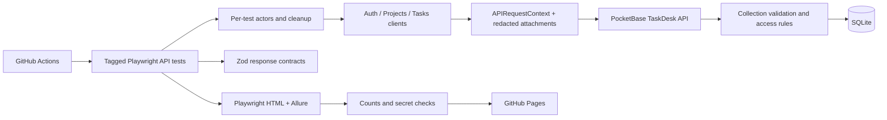

# Architecture

I use PocketBase's unmodified API engine with a version-controlled TaskDesk migration. The application owns data validation, authentication, SQLite transactions and access rules. The framework owns HTTP clients, runtime response schemas, isolated fixtures, test assertions and reports.

`src/api/schemas/contracts.ts` supplies runtime schemas and inferred TypeScript response models. Request models use explicit field subsets. Negative tests intentionally allow unknown request values. Clients return native APIResponse objects so status codes remain observable. The base client adds redacted evidence without replacing Playwright transport. All tests have zero retries. A member owns its projects, tasks belong to projects, and cascading delete provides safe cleanup of only owned resources.

I isolate report directories by `RUN_ID` and scope. `scripts/run.mjs` preserves runner exit codes and rejects unexpected skips, flaky outcomes or zero-test runs. `scripts/report.mjs` reconciles Allure counts against the Playwright JSON summary and checks credential redaction. The CI publishing job requires the test job to succeed. No browser dependency is installed.
